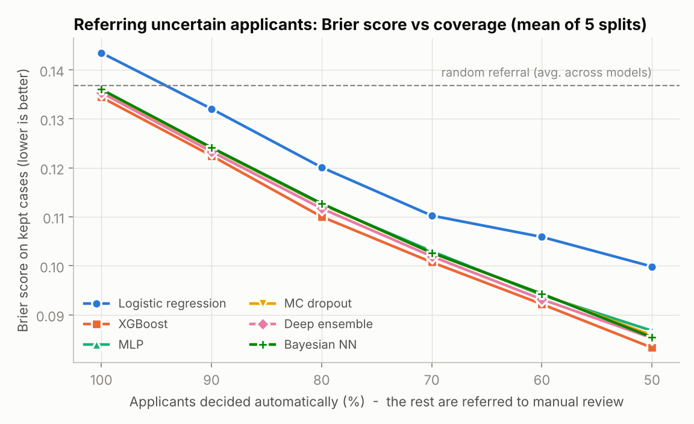
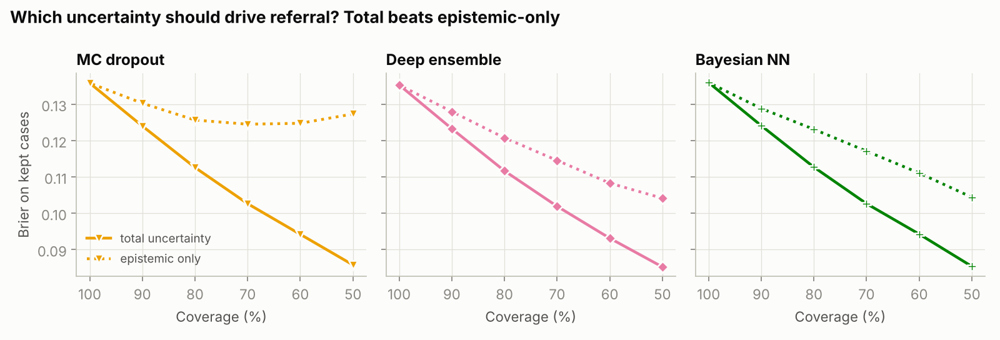
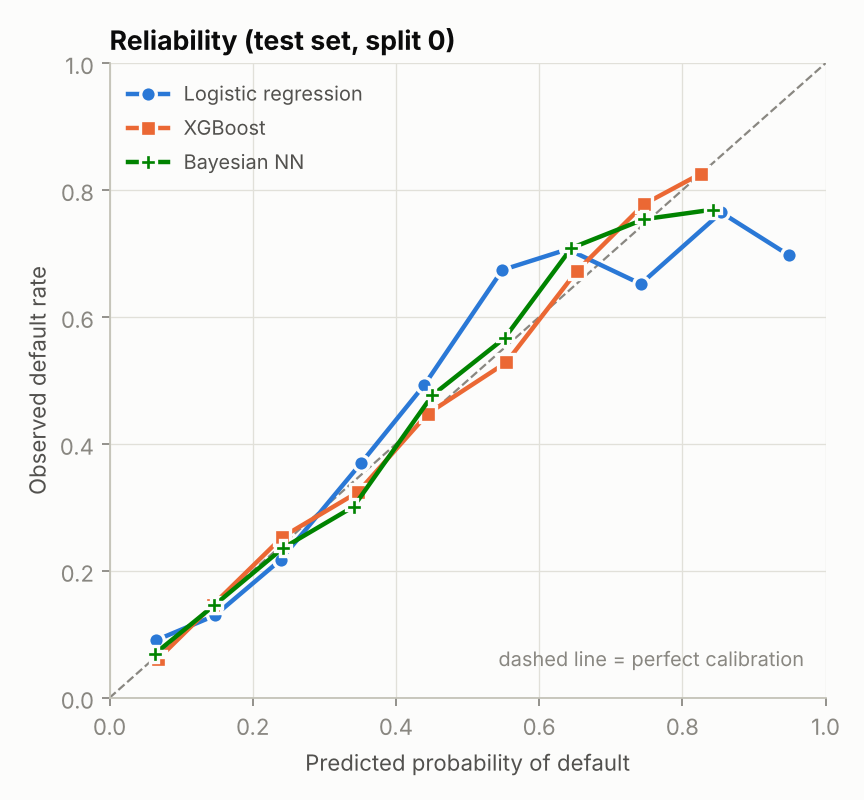

# Bayesian Deep Learning for Credit Risk

**Do Bayesian neural networks earn their keep in credit-default prediction?**
This repo benchmarks PyTorch Bayesian and uncertainty-aware neural networks against
XGBoost and logistic regression on the UCI *Default of Credit Card Clients* dataset
(30,000 Taiwanese card holders, 22% default rate). It looks at three things:
**discrimination** (how well each model ranks risk), **calibration** (whether the
predicted probabilities can be trusted) and **selective prediction** (whether the
model's uncertainty can decide which applicants a human underwriter should review).

## Models

| Model | Type | Uncertainty |
|---|---|---|
| Logistic regression | scikit-learn baseline | predictive entropy |
| XGBoost | gradient-boosted trees, early-stopped | predictive entropy |
| MLP | PyTorch, 64-32 ReLU, dropout 0.2 | predictive entropy |
| MC dropout | same MLP, 50 stochastic passes at test time | total + epistemic |
| Deep ensemble | 5 independently initialised MLPs | total + epistemic |
| **Bayesian NN** | PyTorch, mean-field Gaussian posterior trained with Bayes by Backprop and the local reparameterisation trick, 50 posterior samples | total + epistemic |

For the stochastic models, total predictive uncertainty is split into aleatoric
(expected entropy) and epistemic (mutual information) parts.

## Results

Test set, mean ± std over **5 stratified 60/20/20 splits** (18,000 train / 6,000 val / 6,000 test).
AURC is the mean Brier score over coverages from 10% to 100% when the most uncertain
applicants are referred first. Lower is better for every column except ROC-AUC and PR-AUC.

| Model | ROC-AUC | PR-AUC | Brier | NLL | ECE | AURC (total) | AURC (epistemic) |
|:--|:--|:--|:--|:--|:--|:--|:--|
| Logistic regression | 0.743 ± 0.007 | 0.499 ± 0.012 | 0.1435 | 0.457 | 0.028 | 0.107 | – |
| **XGBoost** | **0.781 ± 0.006** | **0.555 ± 0.013** | **0.1344** | **0.428** | **0.013** | **0.087** | – |
| MLP | 0.776 ± 0.007 | 0.543 ± 0.015 | 0.1359 | 0.433 | 0.015 | 0.089 | – |
| MC dropout | 0.776 ± 0.007 | 0.543 ± 0.015 | 0.1359 | 0.433 | 0.014 | 0.089 | 0.133 |
| Deep ensemble | 0.777 ± 0.007 | 0.546 ± 0.016 | 0.1354 | 0.431 | 0.014 | 0.089 | 0.108 |
| Bayesian NN | 0.776 ± 0.006 | 0.542 ± 0.015 | 0.1360 | 0.433 | 0.018 | 0.090 | 0.106 |

Full tables (with standard deviations) are in [`results/summary.md`](results/summary.md),
per-split numbers in [`results/per_seed_metrics.csv`](results/per_seed_metrics.csv), and
selective-prediction numbers in [`results/selective_metrics.csv`](results/selective_metrics.csv).







## Findings

1. **XGBoost is still the model to beat on tabular credit data.** It leads on every
   metric. Its ROC-AUC gap over the best neural model (+0.004 over the deep ensemble)
   is within one standard deviation across splits, and XGBoost won in 4 of the 5
   splits, so the gap is small and not decisive.
2. **Bayesian treatment of the weights did not improve accuracy or calibration** over
   a plain MLP here. With 18,000 training rows and 31 features, the posterior
   over weights is narrow, so the BNN behaves almost like its point estimate.
3. **For deciding who gets manual review, total uncertainty beats epistemic
   uncertainty alone.** Referring the 30% most uncertain applicants by predictive
   entropy cuts the BNN's Brier score on the cases it keeps from 0.136 to 0.103.
   Ranking by epistemic uncertainty only gets to 0.117, and with MC dropout
   epistemic-only referral barely beats random referral. In this dataset most of the
   risk comes from genuinely ambiguous applicants (aleatoric noise), not from the
   model lacking data.
4. **Among the epistemic signals, the BNN's is the most informative** (lowest
   epistemic AURC, 0.106 vs 0.108 for the ensemble and 0.133 for MC dropout), and it
   costs about a third of the ensemble's training time.

**Takeaway for a lender:** use gradient boosting for the score, and use predictive
entropy (from any well-calibrated model) to route borderline applicants to underwriters.
A BNN is worth it only if you specifically need an epistemic signal, for example to
flag applicants unlike anyone in the training data.

## Limitations

- One dataset from one market (Taiwan, 2005), so the results may not transfer to other portfolios.
- The dataset has no application date, so the splits are random rather than out-of-time.
  A production credit model should be validated on a later time window.
- Hyperparameters were set once from common defaults and not tuned per model.
  Tuning could narrow or widen the gaps.
- Only mean-field variational inference was tested. HMC or SWAG posteriors may behave differently.
- The analysis covers prediction quality only, not fairness across the sex, age or
  marital-status attributes that the dataset contains.

## Reproduce

```bash
git clone https://github.com/vyshailendraa-cmd/bayesian-credit-risk
cd bayesian-credit-risk
pip install -r requirements.txt
python run_experiments.py   # about 3 minutes on a laptop CPU, downloads the data on first run
python make_figures.py
pytest -q
```

The data is downloaded automatically from the UCI repository via `ucimlrepo`. You can
also place the UCI `.xls`/`.csv` or Kaggle's `UCI_Credit_Card.csv` in `data/raw/`.

## Project structure

```
credit_risk/
  data.py      loading, cleaning, feature engineering, stratified splits
  models.py    MLP, BayesLinear (Bayes by Backprop), BNN
  train.py     training loops with early stopping, predictive sampling, baselines
  metrics.py   ROC/PR-AUC, Brier, NLL, ECE, uncertainty decomposition, risk-coverage
run_experiments.py   runs all models over 5 seeds and writes results/
make_figures.py      builds results/figures/
tests/               unit tests for metrics and the Bayesian layer
```

## References

- Yeh, I. C. & Lien, C. H. (2009). The comparisons of data mining techniques for the predictive accuracy of probability of default of credit card clients. *Expert Systems with Applications*, 36(2).
- Blundell, C. et al. (2015). Weight Uncertainty in Neural Networks. *ICML*.
- Kingma, D. P., Salimans, T. & Welling, M. (2015). Variational Dropout and the Local Reparameterization Trick. *NeurIPS*.
- Gal, Y. & Ghahramani, Z. (2016). Dropout as a Bayesian Approximation. *ICML*.
- Lakshminarayanan, B. et al. (2017). Simple and Scalable Predictive Uncertainty Estimation using Deep Ensembles. *NeurIPS*.
- Grinsztajn, L. et al. (2022). Why do tree-based models still outperform deep learning on tabular data? *NeurIPS Datasets and Benchmarks*.

## Author

Vyshailendra Azryl Pathma Raja · [LinkedIn](https://linkedin.com/in/vyshailendra-azryl)
